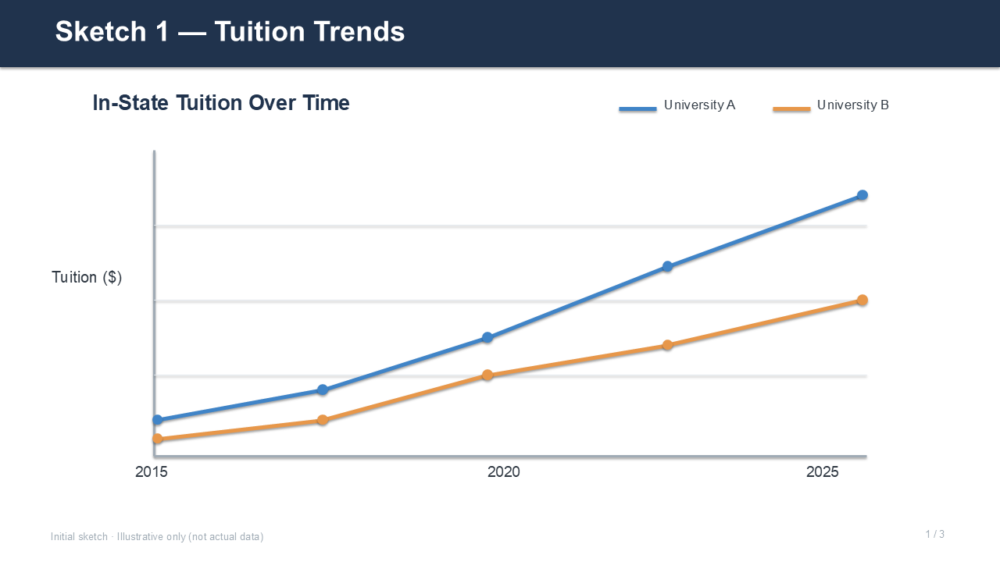
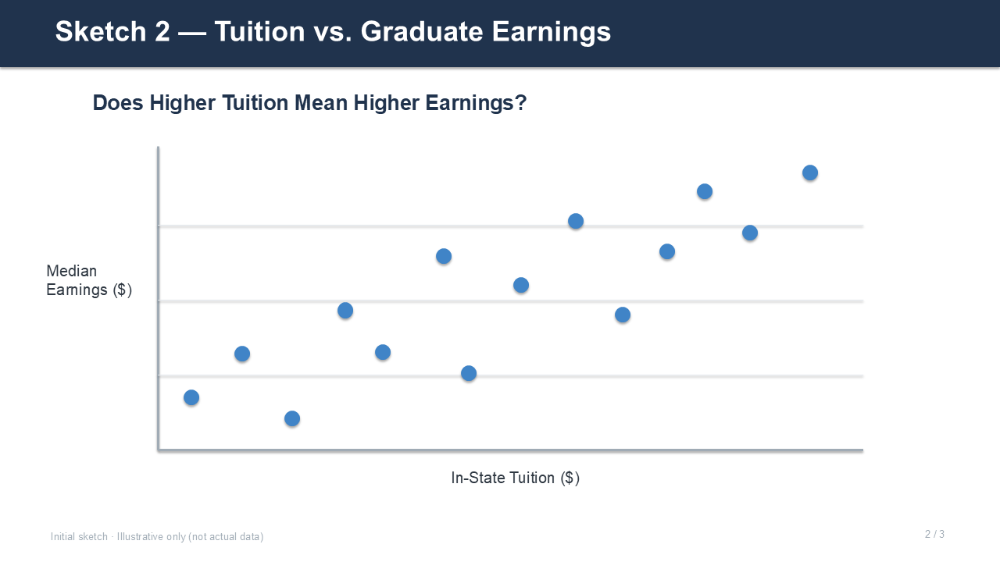
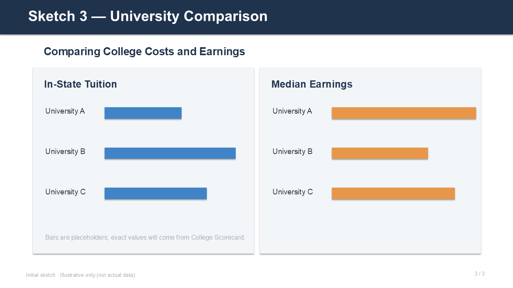

| [home page](https://juefuli.github.io/my-data-portfoli/) | [data viz examples](https://juefuli.github.io/my-data-portfoli/dataviz-examples.html) | [critique by design](https://juefuli.github.io/my-data-portfoli/critique-by-design.html) | [final project I](https://juefuli.github.io/my-data-portfoli/final-project-part-one.html) | [final project II](https://juefuli.github.io/my-data-portfoli/final-project-part-two-site.html) | [final project III](https://juefuli.github.io/my-data-portfoli/final-project-part-three.html) |

# Project Title
**Is the Rising Cost of College Worth It?**

# Outline

**High-Level Summary**

Over the past decade, the cost of higher education in the United States has become an important concern for many students and families. As tuition fees continue to change, many students face an important question: Does paying higher tuition mean earning more after graduation? Although more expensive universities may offer better educational resources and career opportunities, higher tuition does not necessarily guarantee better financial returns. This project aims to use data visualization to explore the relationship between college tuition and graduate earnings, helping readers better understand the costs and potential financial benefits of higher education.

The target audience for this project is prospective college students and their families who are making decisions about higher education. I plan to use publicly available College Scorecard data from the U.S. Department of Education to examine approximately 20–30 public four-year universities. First, I will analyze tuition trends over approximately the past decade. Then, I will compare tuition costs with median earnings after graduation to explore whether there is a relationship between the two. Through interactive data visualizations, I hope to highlight differences across universities and help readers understand why both education costs and future earnings should be considered when choosing a college.

**Project Structure (Story Arc)**

Section 1: Introduction — Is College Becoming More Expensive?

The story will first introduce the background of college education costs in the United States and the financial pressure faced by many families. It will raise the central question of whether higher tuition is associated with higher graduate earnings and draw the audience's attention to the financial value of higher education.

Section 2: The Rising Cost of College

I plan to use a line chart to illustrate changes in college tuition over approximately the past decade. I will examine overall tuition trends and differences in tuition growth across institutions to help the audience understand the background of the issue.

Section 3: Tuition vs. Graduate Earnings

Next, I plan to use a scatter plot to compare tuition costs with median earnings across universities. The main goal is to explore whether universities with higher tuition tend to be associated with higher earnings. I will also highlight universities with relatively low tuition but strong earnings outcomes, as well as those with high tuition but comparatively lower earnings.

Section 4: Comparing the Value of Different Universities

This section will use a bar chart or interactive comparison to examine differences in tuition, average net price, and earnings outcomes among selected universities. By comparing specific institutions, I hope to show why a higher tuition price does not necessarily indicate better financial value and help readers evaluate the relationship between education costs and potential earnings.

Section 5: Conclusion — What Should Students Consider?

Finally, I will summarize the key findings and return to the original research question. I will also discuss other factors that may influence earnings, such as academic major, geographic location, and individual circumstances. The goal is to help prospective students and their families make more informed college decisions by considering both education costs and potential financial outcomes, rather than assuming that a higher tuition price automatically leads to a higher salary.

## Initial sketches

### Sketch 1: Tuition Trends
This sketch shows the planned line chart illustrating changes in college tuition over time.

### Sketch 2: Tuition vs. Graduate Earnings
This sketch shows the planned scatter plot exploring the relationship between tuition costs and graduate earnings.

### Sketch 3: University Comparison
This sketch shows the planned bar chart comparing tuition costs and earnings across selected universities.

Note: These sketches illustrate the proposed visualizations and do not represent final analytical findings.

# The Data

### Data Sources

The primary data source for this project is the College Scorecard dataset published by the U.S. Department of Education. This publicly available dataset contains information about colleges and universities across the United States, including tuition fees, average net prices, and student earnings outcomes. I plan to focus on approximately 20–30 public four-year universities and examine their tuition trends over the past decade, using historical data from approximately 2015 to 2025.

For graduate earnings, I plan to use the median earnings four years after completion (MD_EARN_WNE_4YR), which provides information about the earnings of eligible former students who received federal financial aid. I will compare this measure with in-state tuition (TUITIONFEE_IN) and average net price (NPT4_PUB). These variables will help me explore whether universities with higher tuition costs are associated with higher earnings. Since tuition and earnings data may represent different years and student groups, these differences will be considered when interpreting the results.

### How the Data Will Be Used

I plan to create three main visualizations using Tableau Public. First, a line chart will illustrate changes in tuition fees over time. Second, a scatter plot will examine the relationship between tuition costs and median earnings across universities. Finally, a bar chart will compare selected universities with different tuition and earnings levels. Together, these visualizations will help the audience better understand the potential financial value of higher education and whether paying more for college is associated with better earnings outcomes.

### Dataset Links

The following datasets and documentation are publicly available from the U.S. Department of Education's College Scorecard website.

| Name | URL | Description |
|------|-----|-------------|
| Most Recent Institution-Level Data | [Download ZIP](https://ed-public-download.scorecard.network/downloads/Most-Recent-Cohorts-Institution_11022026.zip) | Contains university-level information, including tuition fees, net prices, and graduate earnings data. |
| Historical College Scorecard Data | [Download ZIP](https://ed-public-download.scorecard.network/downloads/College_Scorecard_Raw_Data_11022026.zip) | Contains historical institutional data that can be used to examine tuition trends over time. |
| College Scorecard Data Dictionary | [View Documentation](https://collegescorecard.ed.gov/data/data-documentation/) | Explains the definitions of variables, data sources, and reporting periods. |

**Source:** U.S. Department of Education. (2026). *College Scorecard*. https://collegescorecard.ed.gov/data/
# Method and medium

For my final project, I plan to use Tableau Public to create interactive data visualizations, including line charts, scatter plots, and bar charts. I will use Shorthand to organize these visualizations into an interactive data story, combining charts, explanations, and key findings. I will also use GitHub Pages to document my progress and provide access to my project. The final product will be a publicly accessible, interactive website that helps readers understand the relationship between college tuition and graduate earnings.

## References

1. U.S. Department of Education. (n.d.). *College Scorecard*. https://collegescorecard.ed.gov/data/

2. U.S. Department of Education. (n.d.). *College Scorecard Data Documentation*. https://collegescorecard.ed.gov/data/data-documentation/

3. Berinato, S. (2016). *Good charts: The HBR guide to making smarter, more persuasive data visualizations*. Harvard Business Review Press.

## AI Acknowledgements

I used ChatGPT to help me understand the assignment requirements, brainstorm and refine my project topic, identify potential data sources, and develop the initial story structure and visualization ideas. I also used ChatGPT to help draft and improve the wording and grammar of my written explanations. I reviewed the project content and will verify the data sources and create the final visualizations myself.

